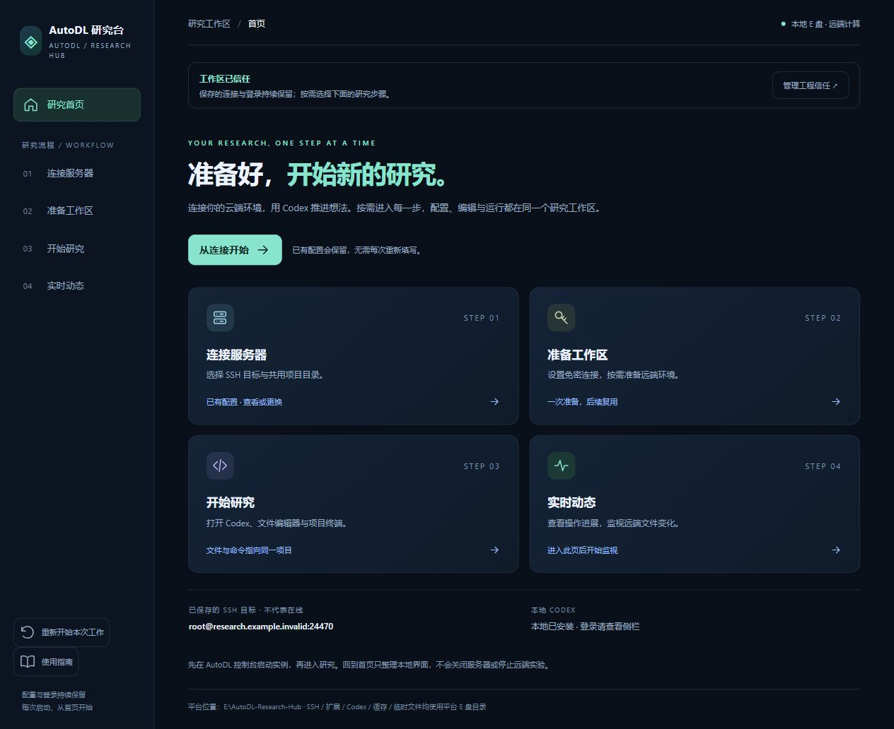

# AutoDL 研究台

[项目仓库](https://github.com/ZXLab2005/AutoDL-Research-Hub) · [MIT 许可证](LICENSE) · [第三方说明](THIRD_PARTY_NOTICES.md) · [隐私与发布说明](PRIVACY.md)

一个面向 **Windows 10/11 x64** 的便携远端科研工作台。将整个研究台文件夹打包，换电脑后解压，双击 **AutoDL研究台.exe**。启动器从自身所在位置识别目录，准备缺失的本地运行组件并打开分步首页，无需手改 JSON 中的盘符路径。

默认使用 **Windows Codex + 免密 SSH**：本机负责对话和编辑入口，Linux 服务器保存代码、Conda 环境、数据与实验结果。可选的远端 Codex CLI 入口适用于需要直接在服务器运行 Codex 的场景。



预览使用演示连接；实际连通情况以 SSH 验证为准。

## 压缩 → 解压 → 双击

**自己换电脑并保留现有配置与登录**：关闭研究台和同步器后，私下压缩、传输整个原文件夹（包含 `data/`、`.agent-sync/`），解压后从新位置双击 EXE。不要使用下面的安全导出，因为安全包会排除账号数据。登录是否仍有效取决于账号服务和设备校验；云端研究文件不会随本机文件夹一起复制。

**需要干净的分享包时**，使用以下流程：

1. **在已配置的研究台导出轻量包**：在平台根目录打开 PowerShell，运行下方命令。轻量分享包包含平台源码、根目录 EXE 和文档，排除第三方运行组件、登录、SSH 密钥、缓存和 Git 历史。

   ```powershell
   & '.\scripts\Export-Portable.ps1' -NoRuntime
   ```

2. **把生成的 ZIP 复制到另一台 Windows 电脑，完整解压**到一个有写入权限的本地目录，例如 `D:\Research\AutoDL-Research-Hub`。可使用其它本地盘符，路径允许空格与中文。不要只复制 EXE，也不要在压缩包内直接运行。
3. **双击文件夹内的 `AutoDL研究台.exe`**。启动器自动定位当前目录；缺失的依赖需要联网下载，已有运行组件会复用。程序、配置、扩展、缓存与临时文件放在当前平台文件夹内。
4. **首次设置自己的连接和登录**：按 VS Code 正常流程信任工作区，在首页配置 SSH、登记公钥并验证免密，然后登录本地 Codex。安全分享包不携带原使用者的账号登录。

导出的 ZIP 默认位于 `data/exports/`。目标电脑首次启动从官方渠道下载依赖。对外分发使用 `-NoRuntime`；包含运行组件的完整包仅用于本人迁移，第三方软件仍受各自许可条款约束。详细说明见 [便携打包与迁移](PORTABLE-GUIDE.md)。GitHub 源码仓库不存放大体积运行组件和个人数据。

这是 Windows 应用，不承诺 EXE 可在 Linux 或 macOS 上运行。服务器上的研究数据和环境不会随本地文件夹迁移。首次下载、扩展安装、账号登录和 SSH 网络连接仍需要对应服务可用。

## 四步开始研究

首页只展示四个流程入口与已保存配置摘要；点击后才进入具体配置，高级功能默认折叠。

| 步骤 | 操作 |
| --- | --- |
| **1 · 连接服务器** | 在 AutoDL 控制台自行开机，复制 SSH 命令，保存主机、端口和共用远端项目目录。 |
| **2 · 准备工作区** | 生成或复用平台专用密钥，登记公钥、验证免密；按需准备远端环境和代理隧道。 |
| **3 · 开始研究** | 手动打开本地 Codex、远端编辑器或项目终端；需要时展开远端 Codex CLI。 |
| **4 · 实时动态** | 查看本次工作中通过 SSH 桥接发起的操作，以及远端目录的文件变化。 |

本地 Codex、远端文件浏览器和项目终端共用保存的 `remotePath`。默认目录为 `/root/autodl-tmp/research-hub/projects`；已有项目位于其它位置时，先修改并保存该字段。

不同终端仍是独立 Shell：临时环境变量、`cd` 和 Conda 激活状态不会自动传到另一个终端。代码直接保存在服务器上，不会自动变成本机与服务器的双向镜像。标题中的 `[SSH: ...]` 也不代表连接已完成，研究前可执行 `pwd; hostname` 核对。

## 每次回到干净首页

通过 EXE 重新启动，或点击“重新开始本次工作”，会返回首页、折叠操作区、清空本次活动展示并隐藏终端与侧栏。下一次启动不自动恢复旧终端和已保存的编辑标签。

连接设置、SSH 密钥、Codex 登录与历史对话、研究文件、历史日志继续保留。未保存的编辑和恢复备份也保留。界面重置不主动结束远端任务；关闭终端或关机造成 SSH 断线仍可能影响前台程序，长期训练应使用 `tmux`、`nohup` 等后台方式。[应用入口与重置说明](APP-GUIDE.md)

## 程序和数据放在哪里

```text
AutoDL-Research-Hub/
├─ AutoDL研究台.exe            相对自身目录定位的启动入口
├─ app/
│  ├─ node/node.exe             本地 Node.js
│  ├─ vscode/Code.exe           VS Code 编辑器
│  ├─ git/cmd/git.exe           Git
│  ├─ gh/bin/gh.exe             GitHub CLI
│  └─ openssh/                 按需准备的便携 SSH 客户端
├─ launcher/                   启动器源码与固定版本依赖清单
├─ src/                        首页、连接、活动与监视源码
├─ scripts/                    自动准备、启动、导出与 SSH 桥接
├─ remote/                     Linux 端辅助脚本
├─ workspace/                  本地 Codex 操作约定
├─ research/Search-R1-repro/    复现辅助文件与已验收的 CPU 检查快照
├─ github-sync/                本平台的 GitHub 同步工具
├─ data/                       本机连接、认证、扩展、缓存、日志与导出包
└─ .agent-sync/                GitHub 同步认证、配置与运行状态
```

本机当前部署仍在原 E 盘目录内；便携包不再要求目标电脑必须有 E 盘。平台只重定向自身及所启动进程的可配置存储，Windows 与原有应用的系统记录不由平台控制。平台目录需要写权限；不建议放在 `Program Files` 等受保护位置。平台不跟随符号链接或 junction 扩大存储与发布范围。

需要可用的 Windows PowerShell 5.1；启动器复用包内或系统 OpenSSH，缺失时准备平台内的便携客户端。远端为可通过公钥登录的 Linux 主机，目录监视需要 Python 3。本机代理可在“连接服务器 → 代理与网络配置”调整。普通 SSH 不依赖反向代理隧道；远端需要借用本机代理时才开启。

[launch-config.example.json](launch-config.example.json) 仅展示相对平台根目录的组件布局。实际 `launch-config.json` 由程序按当前位置生成可执行路径，并在移动后更新；不需要复制样例或手工填写盘符。

## Codex 如何操作服务器

本地模式无需在服务器安装 Codex。在平台根目录的 PowerShell 中可核对当前目标：

```powershell
& '.\scripts\Invoke-AutoDL.ps1' `
  -Command 'pwd; hostname' `
  -Label '确认远端研究目录' `
  -TimeoutSeconds 30
```

桥接每次读取当前 `data/connection.json`，核对目标后进入共用远端目录。复杂命令可使用 `-ScriptPath` 传入保存在平台 `data/temp/` 的 UTF-8 Bash 文件；本地等待超时不保证远端任务已结束。

主动选择远端 Codex 时，入口按需安装或复用 CLI，优先使用远端已有登录，否则按已授权流程检测本机 `auth.json` 并通过 SSH 准备远端独立认证目录。凭据不会放入研究代码、界面或日志。新服务器仍需要登记公钥和核对 SSH 主机指纹。[远端配置与限制](REMOTE.md)

已测试的 AutoDL 容器存在 Linux namespace 限制；远端模型网络可用不代表沙箱可执行命令。平台不自动关闭沙箱或绕过审批。默认本地 Codex + SSH 仍可使用。

## 实时动态与 GitHub 同步

“实时动态”显示实际工具调用摘要和文件变化，不展示 Codex 内部思考或转录全部对话。操作约每 2 秒刷新，文件元数据约每 3 秒扫描一次；只有进入该页且页面可见、工作区已信任时才启用监视。离开页面停止监视，重新进入建立新快照，不补录离开期间的变化。[实时界面说明](LIVE-UI-GUIDE.md)

GitHub 同步仅针对 **本研究台文件夹内通过检查的源码、文档和正式辅助文件**。不上传上级 Agent 中的技能与文献，不自动备份 SSH 服务器，不上传 `app/`、`data/`、`.agent-sync/`、认证或 PDF。文件变化后约 30 秒检查，另有 60 秒补充检查；需要后台进程运行和网络可用。人工暂存、远端分叉或安全检查失败时暂停，不强制推送。[同步指南](github-sync/README.md) · [发布范围](github-sync/PUBLISH-SCOPE.md)

安全分享包不会携带 GitHub 授权与仓库配置。目标电脑要自动上传时，需选择自己的仓库并完成一次官方 GitHub CLI 授权。原已配置机器继续使用现有设置。

## Search-R1 复现辅助

[research/Search-R1-repro](research/Search-R1-repro/README.md) 保留辅助脚本、环境规范和历史 CPU 检查记录，需配合 [Search-R1 官方仓库](https://github.com/PeterGriffinJin/Search-R1) 指定提交使用。

原服务器的 `searchr1`、`retriever` 两个环境已配置并完成依赖和 CPU 小型功能检查。GPU 内核、官方模型检索推理、真实 E5 检索、准确率评测与训练尚未完成，模型权重未下载。换服务器需要重新建环境并验证；CPU 检查通过不等于论文复现。[环境指南](SEARCH-R1-GUIDE.md)

## 开发与验证

从 GitHub 下载的是源码，未包含 EXE 和运行组件。先在根目录运行 `& '.\scripts\Build-Launcher.ps1'`，即可用 Windows 自带的 .NET Framework 编译器生成 EXE；随后双击该 EXE 自动准备依赖。已生成的便携 ZIP 可以直接解压使用。

运行组件准备好后，在平台根目录运行：

```powershell
& '.\app\node\node.exe' --test tests/*.test.js github-sync/*.test.js
```

如只想准备依赖而不打开编辑器：

```powershell
& '.\scripts\Bootstrap-Hub.ps1' -Root (Get-Location).Path -PrepareOnly
```

同步器测试见其 [开发说明](github-sync/README.md#开发测试)。自动测试不能替代真实 SSH、代理、账号登录、模型服务与 GPU 验证。

## 开源许可

本项目自有代码采用 [MIT License](LICENSE)。Search-R1 改编推理与检索脚本保留 Apache-2.0 许可，具体范围、上游来源和修改说明见 [第三方说明](THIRD_PARTY_NOTICES.md)。VS Code、Codex、模型、数据集及其它外部依赖不因本项目开源而改变许可；使用者需自行取得所需账号和资源。
